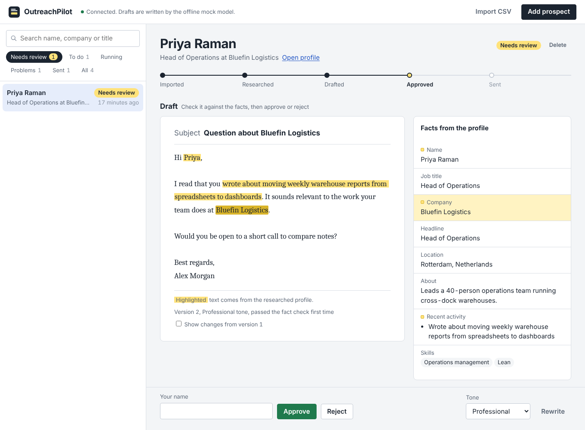
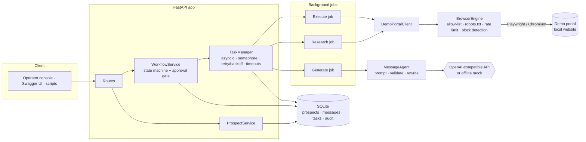
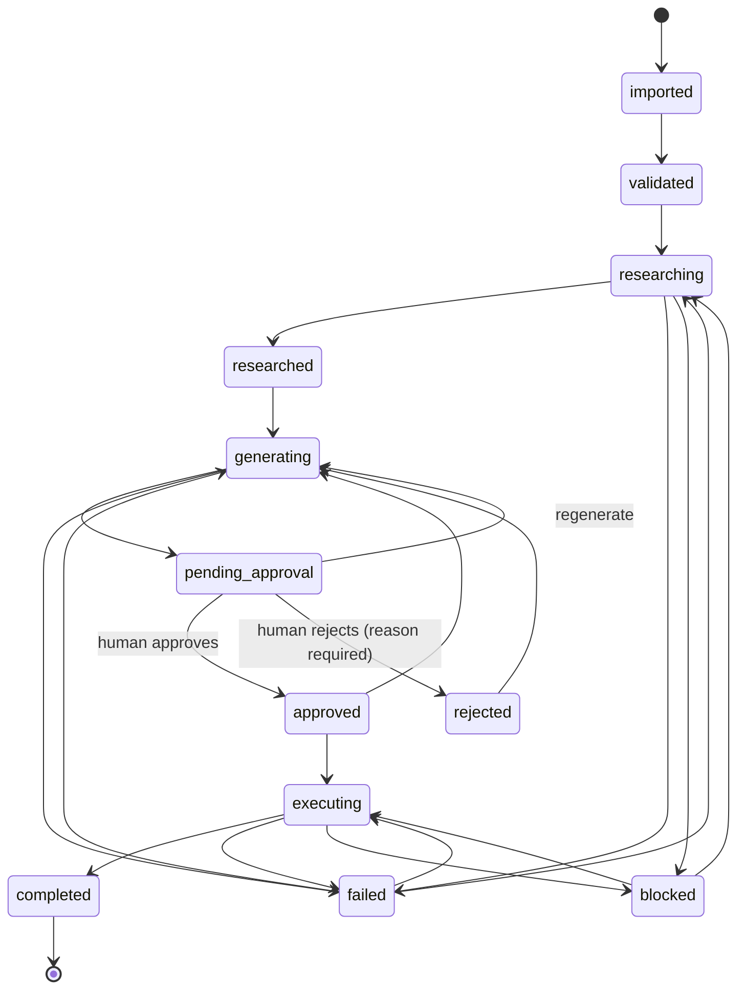

# OutreachPilot

[](https://github.com/lightened1/outreachpilot/actions/workflows/ci.yml)

An AI-assisted outreach workflow that runs on **browser automation**, with a **human approval** step that nothing can skip.

OutreachPilot imports prospects. It researches each one with Playwright on a website and drafts a personalised message with an LLM, using only facts it actually found. It then waits for a person to approve the draft. Only after approval does it send the message through the website's own form. Every step runs as a tracked background task with retries, timeouts and rate limits, and every step is written to an audit trail.

Reviewers work in a built-in **operator console** (served at `/`). It shows each draft next to the facts it was built from, highlights every phrase that came from research, keeps every version with a word-level diff, and records who approved or rejected what.



The project includes its own **local demo portal**, a small website with fictional people, a login, search, profile pages and a message form. Everything can be run and shown end to end with no third-party accounts, no scraping of real platforms and no API key, because a deterministic mock LLM is used when no key is set.

> **Responsible automation.** OutreachPilot uses an honest user agent, respects `robots.txt`, rate-limits navigation per host, and only automates hosts on an explicit allow-list. When a site restricts access (HTTP 403/429 or a verification challenge), the run **stops and reports `blocked`**. There are no CAPTCHA bypasses, stealth plugins, fingerprint spoofing or other anti-bot evasion, by design.

---

## Contents

- [Features](#features)
- [Architecture](#architecture)
- [Tech stack](#tech-stack)
- [Project structure](#project-structure)
- [Installation](#installation)
- [Configuration](#configuration)
- [Running](#running)
- [API](#api)
- [Example workflow](#example-workflow)
- [Testing](#testing)
- [Docker](#docker)
- [Deployment](#deployment)
- [Limitations](#limitations)
- [Future improvements](#future-improvements)

## Features

| Area | What it does |
|---|---|
| **Operator console** | A web UI served by the API, with no build step and a strict Content-Security-Policy. It provides: a review queue with filters and search; drafts shown beside the researched facts with evidence highlighting; approve/reject with reviewer name and reason; rewrite in another tone; version history with a word diff; live task progress with cancel; an activity timeline; add, delete and CSV import. Works on phones. |
| **Browser automation** | Async Playwright engine with one shared browser and an isolated context per job. Features: login with a persisted session (`storage_state`), search, profile extraction through stable `data-testid` selectors, form filling and submission, and screenshots as evidence. Concurrent pages are bounded, and there are separate element and navigation timeouts. |
| **Guarded navigation** | Every `goto` goes through: host allow-list → `robots.txt` → per-host token-bucket rate limit → timeout → HTTP status classification → challenge-page detection. |
| **Prospects** | Full CRUD with Pydantic v2 validation: real-world names (accents, apostrophes, initials), URL normalisation, and duplicate prevention through a unique dedupe key (normalised profile URL, or name + company). Bulk CSV import with header aliases and a per-row report (created / duplicate / invalid). |
| **LLM agent** | Works with any OpenAI-compatible `/chat/completions` API, or with an offline mock. The prompt contains a JSON *facts block*. Every draft is validated before a human sees it: no placeholders, no numbers, links or proper nouns that are missing from the facts, no invented shared history or "congrats on the promotion", a word limit, and a first-name greeting. Invalid drafts are rewritten with the problems fed back, up to N attempts. Internal notes are never sent to the model. |
| **Workflow** | Explicit statuses and a transition table: `imported → validated → researching → researched → generating → pending_approval → approved → executing → completed`, plus `rejected`, `failed` and `blocked`. Illegal transitions return **409**. |
| **Human approval** | The `pending_approval` status, with approve or reject, a reviewer and a reason. A reject requires a reason, and messages are versioned. Execution only ever sends the approved version. |
| **Background tasks** | An asyncio task manager with: a concurrency limit, a per-attempt timeout, bounded retries with exponential backoff and jitter (the concurrency slot is released while waiting), and retryable vs non-retryable error classification. It also supports cancellation and graceful shutdown. Task state and attempt history are stored in SQLite, and tasks interrupted by a restart are marked failed on startup. |
| **Reliability** | Per-host rate limiting, LLM request rate limiting, an idempotency key on sends (a retried send never posts twice), and stale-result protection (a late task result can't overwrite a newer state). |
| **Observability** | Structured logs (JSON or console) with redaction of API keys, bearer tokens, passwords and email addresses. Every request gets an `X-Request-ID`, which is carried into the logs of the background tasks it starts. Failed browser jobs keep a Playwright trace (`playwright show-trace`). Each prospect has an audit trail recording who did what, when, from which task, and with what error. |
| **API** | FastAPI with OpenAPI/Swagger docs and consistent error bodies: `{"error": {"code", "message", "details"}}`. |
| **Security** | API-key authentication (`X-API-Key`, constant-time comparison), required when `ENVIRONMENT=production`. Security headers on every response, optional CORS allow-list, secrets held as `SecretStr` and never logged or returned. |
| **Ops** | Configuration from environment variables, validated at startup. Safe defaults. Dockerfile (non-root, healthcheck) and docker-compose (API + demo portal). CI runs lint and the full test suite. |

## Architecture



Prospect lifecycle (an illegal move returns `409 invalid_transition`):



Design notes are in [`docs/architecture.md`](docs/architecture.md). They cover the composition root, error taxonomy, task manager semantics, the hallucination guard, and how to move the task layer to Redis/Celery.

## Tech stack

Python 3.11+ · FastAPI · Pydantic v2 · SQLAlchemy 2.x (async) + aiosqlite · Playwright (Chromium) · httpx · asyncio · Starlette + Jinja2 (demo portal) · pytest + anyio · ruff · Docker / docker compose

## Project structure

```
outreachpilot/
├── app/
│   ├── main.py              # FastAPI app factory, lifespan, error handlers
│   ├── config.py            # Settings: env vars -> validated, frozen config
│   ├── database.py          # async engine, sessions, SQLite pragmas
│   ├── ui/                  # operator console: index.html, app.css, app.js (served at /)
│   ├── api/                 # routes, dependency providers, API-key check
│   ├── models/              # SQLAlchemy models: Prospect, OutreachMessage, TaskRow, AuditEvent
│   ├── schemas/             # Pydantic request/response models and validators
│   ├── services/            # ProspectService, WorkflowService, SqlTaskStore, Container
│   ├── automation/          # BrowserEngine, robots.txt policy, actions, DemoPortalClient
│   ├── agents/              # MessageAgent, prompts, draft validation, mock + OpenAI clients
│   └── core/                # errors, enums, workflow transitions, TaskManager, retry, rate limit, logging
├── demo/
│   ├── app.py               # local demo portal (login, people, profiles, compose form, robots.txt)
│   ├── data.py              # fictional people, including slow / flaky / blocked / private test cases
│   ├── templates/           # Jinja2 templates with data-testid hooks
│   ├── browser_demo.py      # Playwright showcase: extraction, failures, form submission
│   ├── pipeline_demo.py     # research -> generate -> approve -> send in one terminal
│   └── api_walkthrough.py   # the full workflow through the REST API
├── tests/                   # pytest suite (unit, browser, database, API, end-to-end)
├── docs/                    # architecture notes, demo video script
├── .github/workflows/ci.yml # lint + full test suite on every push
├── .env.example
├── requirements.txt / requirements-dev.txt
├── Dockerfile / docker-compose.yml / .dockerignore
└── pyproject.toml           # pytest + ruff configuration
```

## Installation

Requires Python 3.11+.

```bash
git clone https://github.com/lightened1/outreachpilot.git
cd outreachpilot
python -m venv .venv
source .venv/bin/activate          # Windows: .venv\Scripts\activate
pip install -r requirements-dev.txt
python -m playwright install chromium   # on Linux add --with-deps if system libraries are missing
cp .env.example .env               # optional: every setting has a safe default
```

## Configuration

All settings are environment variables, which can also be put in a `.env` file. They are validated at startup, and an invalid value stops the app with a clear message. See [`.env.example`](.env.example) for the full list. The important ones are:

| Variable | Default | Notes |
|---|---|---|
| `LLM_MODE` | `auto` | `auto` = OpenAI-compatible if `OPENAI_API_KEY` is set, otherwise the offline mock. `mock` / `openai` force a mode. `openai` without a key is a startup error. |
| `OPENAI_API_KEY` / `OPENAI_BASE_URL` / `OPENAI_MODEL` | – / OpenAI / `gpt-4o-mini` | Any OpenAI-compatible endpoint (OpenAI, OpenRouter, a local Ollama or vLLM server…). The key is a `SecretStr` and is never logged. |
| `SENDER_NAME`, `SENDER_ROLE`, `SENDER_COMPANY`, `SENDER_VALUE_PROP` | fictional sender | The only facts about the sender that the model may use. |
| `DEMO_PORTAL_URL` | `http://127.0.0.1:8010` | Where the demo portal runs. |
| `ALLOWED_AUTOMATION_HOSTS` | `127.0.0.1,localhost,demo` | Automation refuses any other host. |
| `RESPECT_ROBOTS_TXT` | `true` | |
| `BROWSER_HEADLESS` / `BROWSER_SLOW_MO_MS` | `true` / `0` | Use `false` / `400` to watch the browser, e.g. for a screen recording. |
| `NAVIGATIONS_PER_MINUTE` / `NAVIGATION_BURST` | `60` / `5` | Token bucket per host. |
| `TASK_MAX_CONCURRENCY` / `TASK_MAX_ATTEMPTS` / `TASK_TIMEOUT_S` | `2` / `3` / `120` | Background task limits. |
| `DATABASE_URL` | `sqlite+aiosqlite:///./data/outreachpilot.db` | |
| `LOG_JSON` | `false` | One JSON object per line when `true`. |
| `API_KEY` | – | Required when `ENVIRONMENT=production`, at least 16 characters. Sent as `X-API-Key`; the console asks for it once and keeps it in the browser. |
| `CORS_ORIGINS` | – | Extra browser origins allowed to call the API. The built-in console needs none. |
| `BROWSER_TRACE_ON_FAILURE` | `true` | Keep a Playwright trace for failed browser jobs in `artifacts/traces/` (the newest 50 are kept). |

`.env`, the database, screenshots and saved browser sessions are all git-ignored. The session files can contain login cookies.

## Running

Use two terminals.

```bash
# 1. the demo portal (http://127.0.0.1:8010, login demo / demo-password)
python -m demo

# 2. the API and console
uvicorn app.main:app --reload --port 8000
```

Open **http://127.0.0.1:8000** for the operator console, or **/docs** for the Swagger UI. In the console, add a prospect with the profile URL `http://127.0.0.1:8010/people/1` (or import a CSV), then click through *Research profile → Write draft → Approve → Send message*. To load all seven demo people at once, use **Import CSV** with [`docs/demo_prospects.csv`](docs/demo_prospects.csv). It includes the slow, flaky, blocked and robots-disallowed cases.

Then run the whole workflow from a third terminal:

```bash
python -m demo.api_walkthrough                        # asks you to approve the draft
python -m demo.api_walkthrough --reject-first --yes   # reject, regenerate in another tone, approve, send
python -m demo.api_walkthrough --person 5             # a profile behind an access challenge -> "blocked"
```

These standalone demos need neither the API nor the database:

```bash
python -m demo.browser_demo --headed --slow-mo 400      # watch login, search, extraction, failure handling, form send
python -m demo.pipeline_demo                            # research -> generate -> approve -> send in one terminal
python -m demo.pipeline_demo --show-hallucination-guard # the validator rejecting an invented statistic
```

## API

Interactive docs: **http://127.0.0.1:8000/docs** (Swagger) and `/redoc`. When `API_KEY` is set, every endpoint except `/health` needs the `X-API-Key` header; use **Authorize** in Swagger.

| Method | Path | Description |
|---|---|---|
| `GET` | `/health` | Database check, config summary (no secrets), task stats. Always public, for load-balancer probes |
| `GET` | `/stats` | Prospect counts by status, task load |
| `POST` | `/prospects` | Import a prospect (validated, de-duplicated) → `201`, or `409 duplicate_prospect` |
| `POST` | `/prospects/import` | `{"csv": "..."}` → per-row report: created, duplicate (with the existing id) or invalid (with reasons) |
| `GET` | `/prospects?status=&status=&q=&sort=&limit=&offset=` | List, filter by one or more statuses, search, sort (`id`, `-id`, `-updated`) |
| `GET` | `/prospects/{id}` | Detail, including the latest message and the allowed next statuses |
| `PATCH` | `/prospects/{id}` | Update fields (refused while a task is running) |
| `DELETE` | `/prospects/{id}` | Delete with its messages and audit trail (refused while a task is running) → `204` |
| `GET` | `/prospects/{id}/messages` | Every message version, newest first |
| `POST` | `/prospects/{id}/research` | Start a browser research task → `202` + task |
| `POST` | `/prospects/{id}/generate-message` | Start message generation (`{"tone": "professional\|friendly\|concise", "extra_instructions": "..."}`) → `202` |
| `POST` | `/prospects/{id}/approve` | `{"decision": "approve"}` or `{"decision": "reject", "reason": "..."}`, with optional `reviewer` |
| `POST` | `/prospects/{id}/execute` | Send the **approved** message through the portal → `202` |
| `GET` | `/prospects/{id}/events` | Audit trail |
| `GET` | `/prospects/{id}/tasks` | Tasks for one prospect |
| `GET` | `/tasks/{id}` | Task status, attempts, result or error, and full history |
| `GET` | `/tasks` | Recent tasks |
| `POST` | `/tasks/{id}/cancel` | Cancel a queued or running task |

Error responses always have this shape:

```json
{"error": {"code": "invalid_transition", "message": "Cannot move prospect from 'validated' to 'executing'.",
           "details": {"current": "validated", "requested": "executing", "allowed": ["researching"]}}}
```

## Example workflow

Uses `curl` and [`jq`](https://jqlang.org/). The demo portal and API must be running.

```bash
API=http://127.0.0.1:8000

# import (duplicates are rejected with 409)
curl -s -X POST $API/prospects -H 'Content-Type: application/json' \
  -d '{"name": "Priya Raman", "source_url": "http://127.0.0.1:8010/people/1"}'
# -> {"id": 1, "status": "validated", ...}

# research in the browser (background task; 202 + task id)
TASK=$(curl -s -X POST $API/prospects/1/research | jq -r .id)
curl -s $API/tasks/$TASK | jq '{status, attempts, history}'   # repeat until "succeeded"
curl -s $API/prospects/1 | jq '{status, research_data}'        # -> "researched"

# generate a draft from the researched facts
TASK=$(curl -s -X POST $API/prospects/1/generate-message -H 'Content-Type: application/json' \
  -d '{"tone": "friendly"}' | jq -r .id)
curl -s $API/tasks/$TASK | jq .status                          # -> "succeeded"
curl -s $API/prospects/1 | jq '{status, latest_message}'       # -> "pending_approval" + the draft

# sending before approval is refused
curl -s -X POST $API/prospects/1/execute            # -> 409 invalid_transition

# approve (or reject with a reason, then regenerate)
curl -s -X POST $API/prospects/1/approve -H 'Content-Type: application/json' \
  -d '{"decision": "approve", "reviewer": "ami"}'

# send through the portal's compose form
TASK=$(curl -s -X POST $API/prospects/1/execute | jq -r .id)
curl -s $API/tasks/$TASK | jq .status                          # -> "succeeded"; prospect is "completed"
curl -s $API/prospects/1/events | jq '.[].event_type'          # full audit trail
curl -s http://127.0.0.1:8010/api/outbox            # what the portal actually received
```

The demo portal includes test people that exercise each failure path:

| Person | Behaviour | Expected outcome |
|---|---|---|
| 1–3 | normal profiles | `researched` |
| 4 Tomás Ferreira | responds after 20 s | timeout → retried → `failed` with `automation_timeout` |
| 5 Hana Sato | access challenge (HTTP 429) | `blocked` immediately, no retries |
| 6 Daniel Kim | returns 503 twice, then works | succeeds on attempt 3 (visible in task history) |
| 7 Sofia Lindqvist | under `/private/`, disallowed by `robots.txt` | `blocked` with `robots_disallowed`, the page is never requested |

## Testing

```bash
pytest                 # everything
pytest -m "not browser"  # skip tests that launch Chromium
ruff check . && ruff format --check .
```

GitHub Actions (`.github/workflows/ci.yml`) runs ruff and the whole suite on every push, with `REQUIRE_FULL_STACK=1` so that no test can be silently skipped.

All LLM calls in tests use the mock client or a stubbed HTTP transport, so tests never need an API key or network access. Browser tests run a real Chromium against the demo portal on a random local port.

| File | Covers |
|---|---|
| `test_validation.py` | Prospect schemas: names, URLs, de-duplication keys, update rules |
| `test_workflow_transitions.py` | Every allowed and forbidden status transition |
| `test_rate_limit_and_retry.py` | Token bucket, keyed limiter, backoff schedule, retry classification |
| `test_task_manager.py` | Concurrency limit, retries, timeouts, non-retryable errors, cancellation, shutdown |
| `test_message_agent.py` | Grounded generation, the validator (invented numbers, names, links, claims), regeneration, giving up |
| `test_openai_client.py` | HTTP client error mapping (401, 429, 5xx, malformed output, timeouts) using `httpx.MockTransport` |
| `test_logging.py` | Redaction of keys, tokens, passwords, emails |
| `test_browser_automation.py` | Real Playwright: login, session reuse, extraction, timeouts, 503 retries, 429 block, robots.txt, allow-list, data mismatch, idempotent sends, page pool limit |
| `test_database.py` | Persistence, unique constraint, task store, recovery of interrupted tasks |
| `test_api.py` | Endpoints, validation errors, duplicates, illegal transitions, approval rules |
| `test_end_to_end.py` | Full API flow: reject → regenerate → approve → send; blocked; flaky retries; cancel; busy refusal |
| `test_ui.py` | The console in Chromium under the production CSP: review queue, evidence highlighting, version diff, reject/approve rules, send with live task polling, blocked notice, API-key prompt, CSV import report, phone layout |

## Docker

```bash
docker compose up --build
# Console:      http://localhost:8000
# API docs:     http://localhost:8000/docs
# Demo portal:  http://localhost:8010   (demo / demo-password)

docker compose exec api python -m demo.api_walkthrough --yes
```

Inside compose, the API reaches the portal as `http://demo:8010`. Import [`docs/demo_prospects_docker.csv`](docs/demo_prospects_docker.csv) in the console to load the demo people with those addresses. Prospects created by hand should therefore use `source_url` values like `http://demo:8010/people/1`; the walkthrough script does this automatically. The image runs as a non-root user. Data, screenshots and browser sessions live in named volumes. To use a real LLM, put `OPENAI_API_KEY` in `.env`; compose picks it up if the file exists.

## Deployment

A production checklist for a single-instance deployment:

1. Set `ENVIRONMENT=production` and a strong `API_KEY`. The app refuses to start in production without one.
2. Run **one** API worker (the image does). Background tasks live in the API process. For more throughput, raise `TASK_MAX_CONCURRENCY` rather than adding workers.
3. Put it behind a TLS-terminating reverse proxy (Caddy, nginx, a cloud load balancer). Health checks go to `GET /health`.
4. Keep `data/`, `artifacts/` and `.sessions/` on persistent volumes, as the compose file does. Back up `data/outreachpilot.db` (SQLite in WAL mode; use `sqlite3 data/outreachpilot.db ".backup backup.db"` for a consistent copy).
5. Set `LOG_JSON=true` and ship stdout to your log system. Correlate with the `request_id` field.
6. Set `OPENAI_API_KEY` (and `OPENAI_BASE_URL` / `OPENAI_MODEL` for other providers) and the `SENDER_*` profile.
7. Only add hosts to `ALLOWED_AUTOMATION_HOSTS` that you are authorised to automate.

## Limitations

- **SQLite and an in-process task queue.** Fine for a single instance, but tasks don't survive a restart (they are marked failed on startup) and can't be shared across workers. See *Future improvements*.
- **Demo portal only.** The `DemoPortalClient` is written against the bundled site's `data-testid` selectors. Automating any other site means writing a new client for it, and doing so only where its terms permit automation.
- **The hallucination guard is a heuristic.** It catches invented numbers, links, capitalised names and common fabricated claims. It cannot catch every false statement written in lowercase prose. This is why human approval is mandatory, not optional.
- **One shared API key, not user accounts.** Reviewers type their name, which is recorded on each decision, but there is no per-user login. Put SSO in front (for example, an identity-aware proxy) if you need it.
- **Schema changes need migrations.** Tables are created on first start. Changing an existing schema later needs a migration tool such as Alembic.
- **Mock LLM output is template-based.** It demonstrates the pipeline but is not a writing-quality benchmark. Set `OPENAI_API_KEY` for real drafts.

## Future improvements

These are the steps for scaling beyond one instance. None of them is needed to run it as it is.

- Move background jobs to Celery or arq on Redis. Jobs already receive only IDs and load their state from the database, and the `TaskStore` protocol isolates persistence. See [`docs/architecture.md`](docs/architecture.md).
- Use PostgreSQL with Alembic migrations for multi-instance deployments.
- Per-user accounts with SSO, and roles (reviewer vs. operator).
- OpenTelemetry traces across API → task → browser → LLM.

## License

MIT. See [LICENSE](LICENSE).
